<p align="center">
  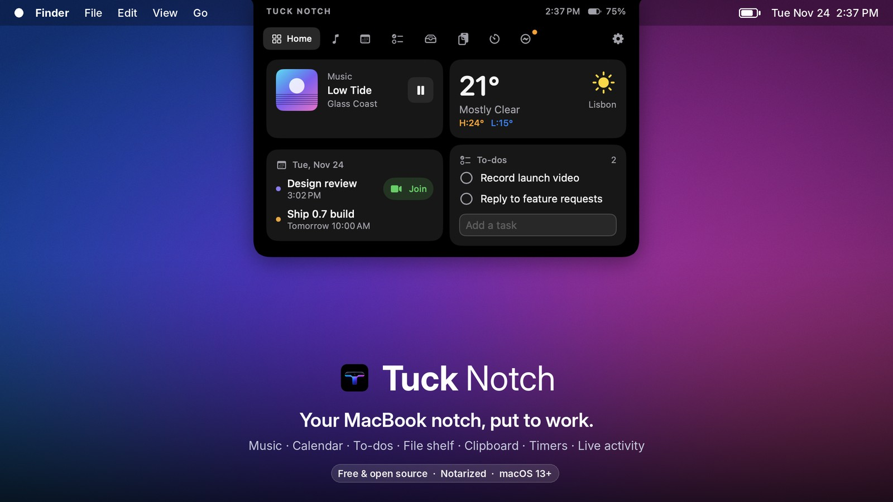
</p>

<p align="center">
  <a href="https://github.com/ASV-Labs/tuck-notch/releases/latest"></a>
  
  
  <a href="LICENSE"></a>
</p>

<h3 align="center">Your MacBook notch, put to work.</h3>

<p align="center">
  A native, privacy-first activity center that grows out of the camera housing.<br>
  Invisible when nothing's happening. Informative at a glance. Actionable when you need it.
</p>

<p align="center">
  <a href="https://github.com/ASV-Labs/tuck-notch/releases/latest"><b>⬇︎ Download the latest release</b></a> &nbsp;·&nbsp;
  <a href="#what-it-does">Features</a> &nbsp;·&nbsp;
  <a href="#privacy">Privacy</a> &nbsp;·&nbsp;
  <a href="https://github.com/ASV-Labs/tuck-notch/issues/new?template=feature_request.yml">Request a feature</a>
</p>

Free and open source. Signed by ASV Labs, notarized by Apple, and it updates itself.

## A look around

<table>
  <tr>
    <td width="50%">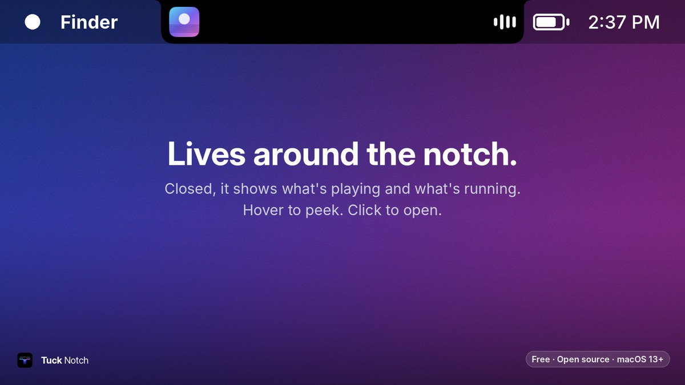<br><b>Lives around the notch.</b> Closed, it shows what's playing and what's running.</td>
    <td width="50%">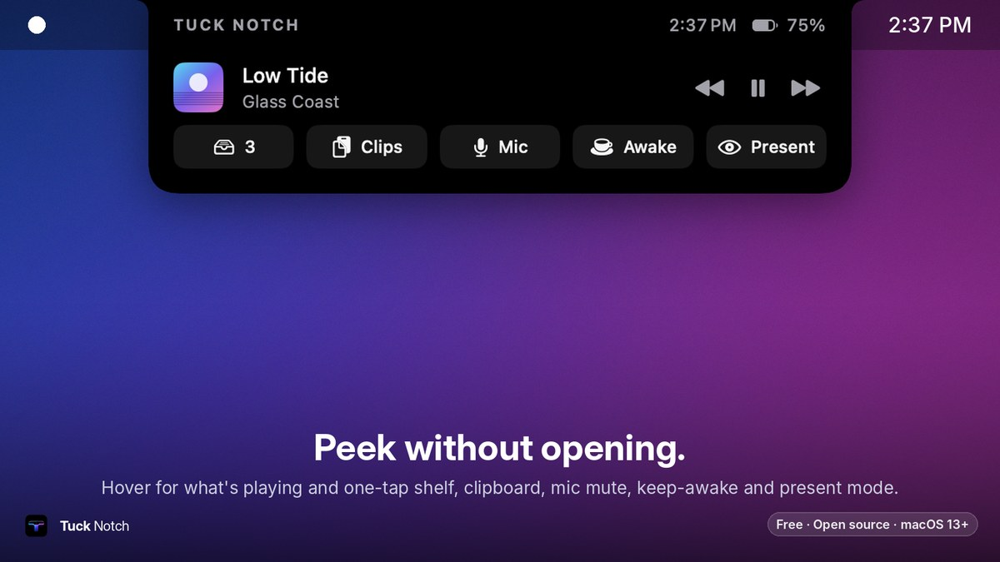<br><b>Peek without opening.</b> Hover for media controls and one-tap shelf, clipboard, mic, keep-awake and present mode.</td>
  </tr>
  <tr>
    <td>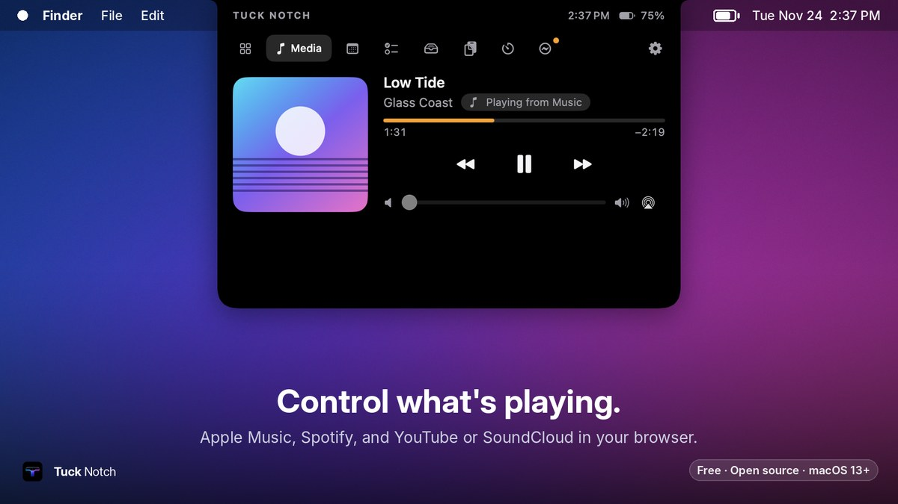<br><b>Control what's playing.</b> Apple Music, Spotify, and YouTube or SoundCloud in your browser.</td>
    <td>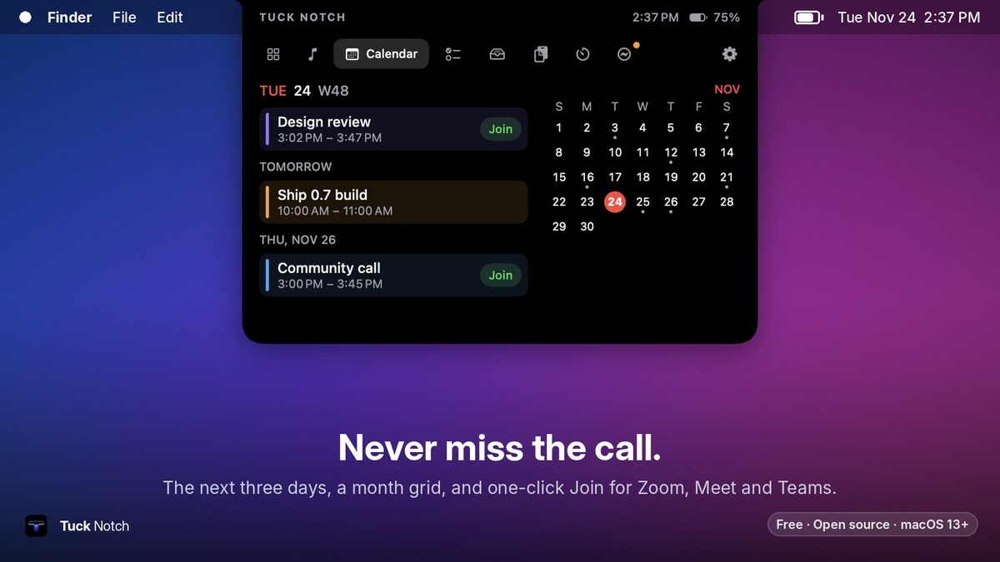<br><b>Never miss the call.</b> The next three days, a month grid, one-click Join.</td>
  </tr>
  <tr>
    <td>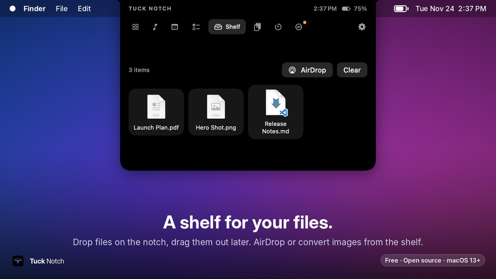<br><b>A shelf for your files.</b> Drop files on the notch, drag them out later.</td>
    <td>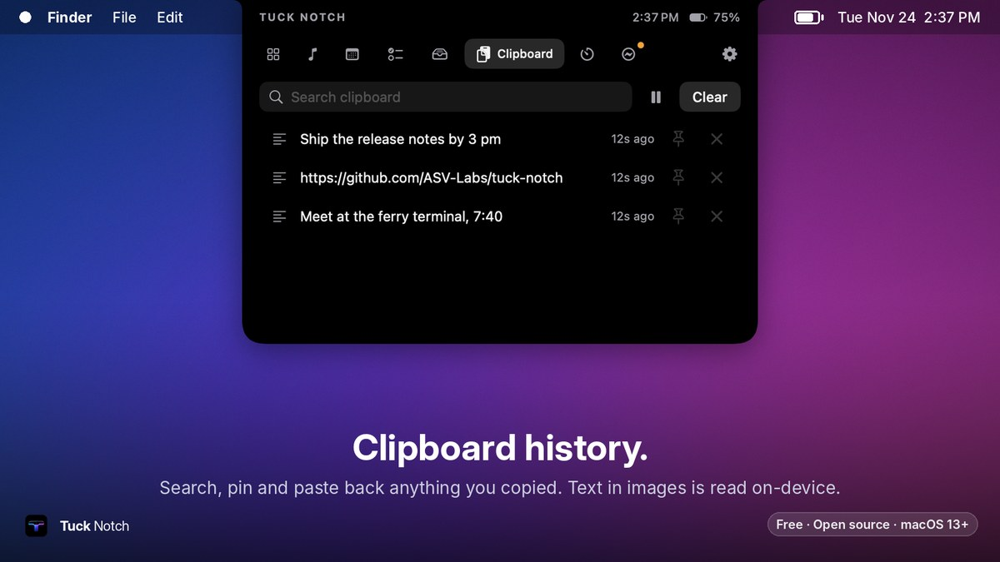<br><b>Clipboard history.</b> Search, pin and paste back what you copied.</td>
  </tr>
  <tr>
    <td>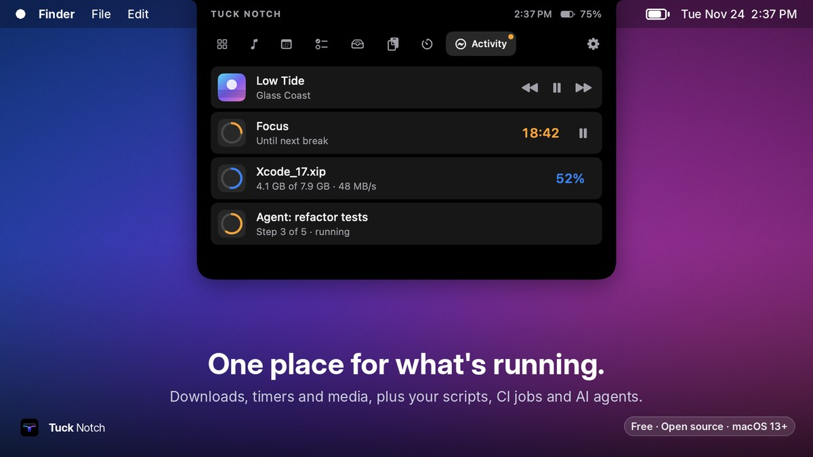<br><b>One place for what's running.</b> Downloads, timers, media, scripts and AI agents.</td>
    <td>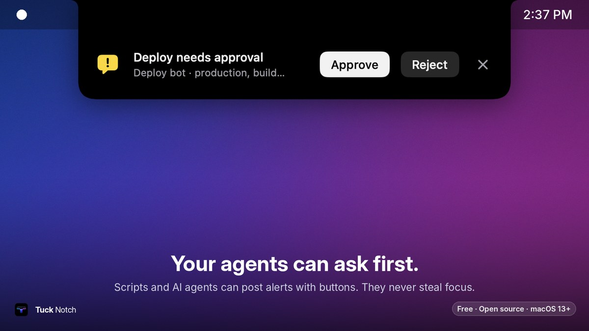<br><b>Your agents can ask first.</b> Alerts with buttons that never steal focus.</td>
  </tr>
  <tr>
    <td>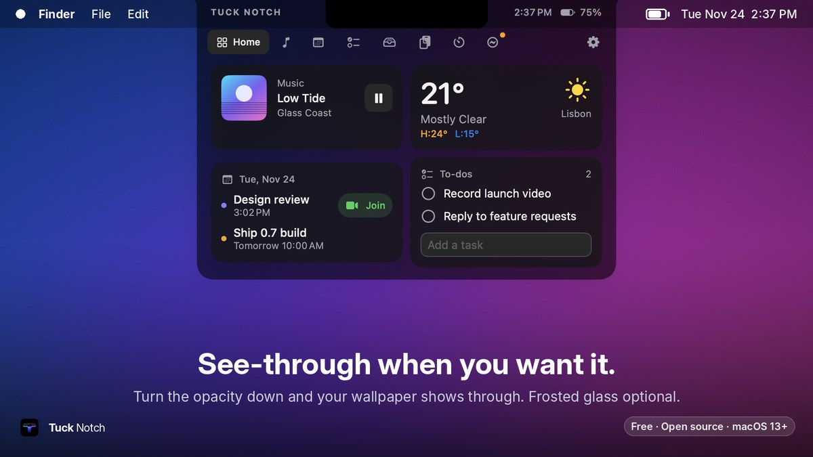<br><b>See-through when you want it.</b> Turn the opacity down; frosted glass optional.</td>
    <td>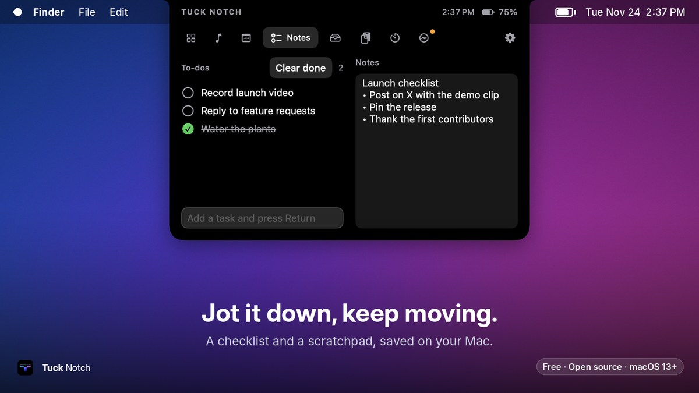<br><b>Jot it down.</b> A checklist and a scratchpad, saved on your Mac.</td>
  </tr>
</table>

<sub>Screenshots are of the real app running with sample content.</sub>

## What it does

Tuck Notch turns the notch into a live island that grows out of the camera housing.

| | |
|---|---|
| **Live activities** | Album art and an equalizer beside the camera while music plays; countdowns, browser downloads, mic-muted and keep-awake indicators. |
| **Media** | Apple Music and Spotify. Optionally YouTube, YouTube Music, SoundCloud and other web players in Chrome, Safari, Arc, Brave and Edge. Artwork, progress, remaining time, controls, volume, output switching, optional synced lyrics. |
| **Home** | Choose up to four cards: Now Playing, YouTube, Weather, Calendar, To-dos, Notes, Pulse (CPU, memory, battery), Focus timer, File shelf, Quick controls, Activity. |
| **Calendar** | The next three days grouped by day, a month grid with busy-day dots and the week number, and a one-click **Join** button for Zoom, Meet, Teams, Webex, FaceTime and Whereby. Works with every calendar on your Mac (including Google through Internet Accounts) and, optionally, one Notion database. |
| **To-dos & notes** | A checklist and a scratchpad, saved on this Mac. |
| **Shelf** | Drop files on the notch and drag them out later. Files stay where they are. AirDrop from the shelf, or convert images to JPEG/PNG. |
| **Clipboard** | History with search, pinning, on-device OCR, per-app exclusions and retention limits. |
| **Focus** | Focus/Break presets and custom timers that live in the notch. |
| **Activity feed** | Optional: scripts, CI jobs and AI agents can post status and buttons to the island (the `tools/tucknotch-activity` script in this repository). |
| **Appearance** | Accent and activity colours, surface style, background opacity (clear or frosted glass), panel size, corners, text size, animation style, and what shows in the notch. |

Five island states (Dormant, Live, Peek on hover, Expanded on click or ⌃⌥K, and Attention for alerts that never steal focus) are managed by one activity engine, so nothing fights for the notch. See [ARCHITECTURE.md](ARCHITECTURE.md).

## Install

**Download:** get `TuckNotch-<version>.dmg` from [Releases](https://github.com/ASV-Labs/tuck-notch/releases/latest), open it and drag Tuck Notch to Applications. Releases are signed by ASV Labs and notarized by Apple, and they update themselves (Settings › General › Updates). Requires macOS 13 or later on a Mac with a notch; other Macs get a small island at the top of the screen.

**Build from source:** you need Xcode (or the Command Line Tools).

```bash
git clone https://github.com/ASV-Labs/tuck-notch.git
cd tuck-notch
./build.sh install      # builds "Tuck Notch.app", copies it to /Applications and launches it
```

Source builds don't update themselves. Tuck Notch lives in the menu bar and has no Dock icon.

## Requests and feedback

- **Feature ideas:** open a [feature request](https://github.com/ASV-Labs/tuck-notch/issues/new?template=feature_request.yml), or 👍 an existing one; votes decide what gets built next. Half-formed ideas are welcome in [Discussions › Ideas](https://github.com/ASV-Labs/tuck-notch/discussions/categories/ideas).
- **Bugs:** use the [bug report](https://github.com/ASV-Labs/tuck-notch/issues/new?template=bug_report.yml) form.
- **Security:** report privately through the [Security tab](https://github.com/ASV-Labs/tuck-notch/security/advisories/new).

### Media from your browser (optional)

Turn on the browsers you use in Settings › Media. Then let the browser share the page's now-playing details once:

- **Chrome / Arc / Brave / Edge:** View › Developer › **Allow JavaScript from Apple Events**
- **Safari:** Settings › Advanced › *Show features for web developers*, then Develop › **Allow JavaScript from Apple Events**

macOS also asks once for permission to control each browser. Tuck Notch reads the address of each open tab to find media sites, and only runs scripts in tabs whose host is a known media site (YouTube, YouTube Music, SoundCloud, Spotify Web, Apple Music Web, Bandcamp, Twitch and a few others). There it reads the title, artist, artwork and position; when you press a control it clicks that site's play/next/previous button or seeks the player.

## Privacy

- No accounts, no analytics, no tracking.
- Clipboard history stays in memory. Only text you pin is saved, in Tuck Notch's preferences file on this Mac.
- To-dos and notes are saved in `~/Library/Application Support/TuckNotch/notes.json`, readable only by you.
- What leaves your Mac:
  - **Weather** (once you pick a city): the city name you type while searching, then your chosen city's coordinates every 30 minutes, to Open-Meteo.
  - **Lyrics** (off by default): the track title and artist (for browser media, the page's media title) to LRCLIB.
  - **Notion** (only if you connect it): read-only requests to api.notion.com for the one database you choose. The secret is stored in your Keychain.
  - **Artwork** (whenever music plays): album art images are downloaded over HTTPS from the player's or site's image URL, without cookies or a disk cache.
  - **Updates** (release builds, can be turned off): once a day the app asks GitHub for the latest release's `appcast.xml`. No usage data is sent.
- Calendar data never leaves your Mac. Google Calendar works through System Settings › Internet Accounts.
- **Presentation mode** hides live content and pauses clipboard history while you share your screen.

Details: [SECURITY.md](SECURITY.md).

## Develop

```bash
swift build && swift test
./verify.command        # build + tests + launch + idle CPU/memory/energy log
./snapshots.command     # render every island state to snapshots/*.png
./demo-tour.command     # run the real app with sample content and capture each state to demo-captures/
```

The snapshot renderer uses your real settings (for example a pinned clipboard item or your weather city). Look at every image before you share it. The demo tour uses throwaway settings and fictional content only, and `tools/marketing/compose.py` turns its captures into the images in `docs/images/`.

Contributions are welcome. See [CONTRIBUTING.md](CONTRIBUTING.md). Maintainers: [RELEASING.md](RELEASING.md). Other docs: [UX-DESIGN-SYSTEM.md](UX-DESIGN-SYSTEM.md) · [TEST-PLAN.md](TEST-PLAN.md) · [ROADMAP.md](ROADMAP.md) · [KNOWN-ISSUES.md](KNOWN-ISSUES.md) · [CHANGELOG.md](CHANGELOG.md)

## License

The source code is licensed under the [Apache License 2.0](LICENSE) © 2026 ASV Labs LLC. Redistributions must keep the [NOTICE](NOTICE) file, which credits ASV Labs.

The artwork files `Resources/Logo.png`, `Resources/AppIcon.png` and `Resources/AppIcon.icns` are **not** covered by the Apache License: they are © ASV Labs LLC, all rights reserved. You may keep them unmodified in copies of this repository; to ship a modified or derived app, replace them with your own icon and use a different name. The screenshots and marketing images in `docs/images/` are © ASV Labs LLC as well. The "Tuck Notch" name is not licensed for other products.
